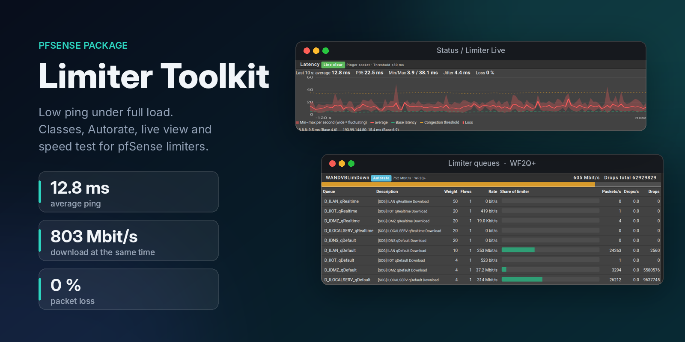
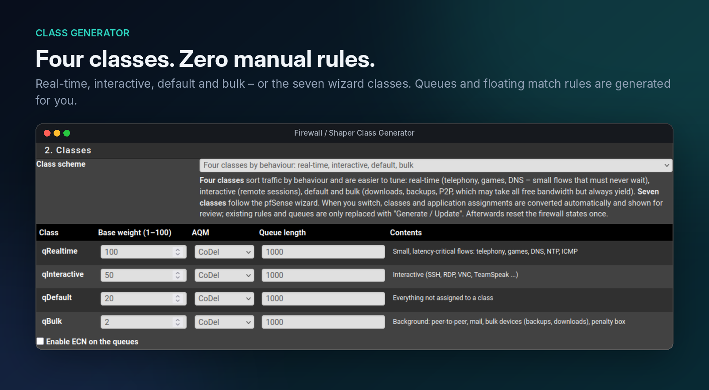
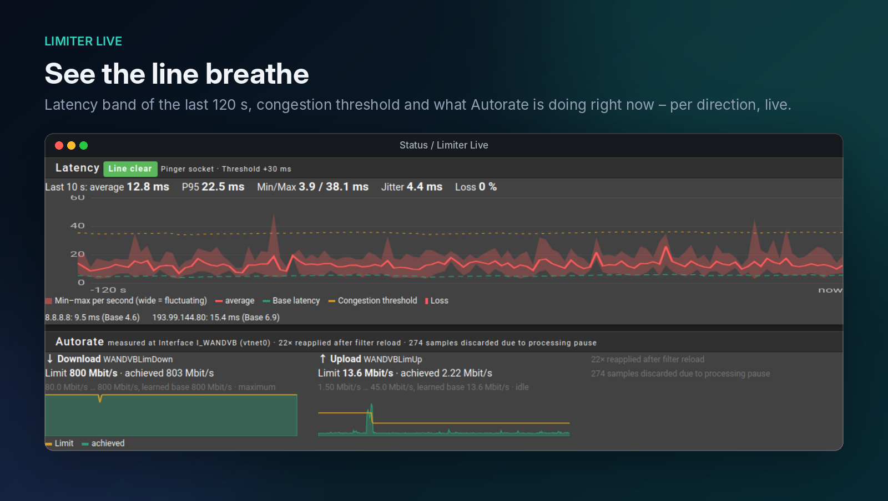
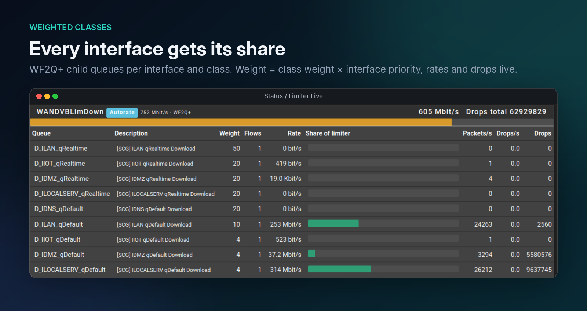
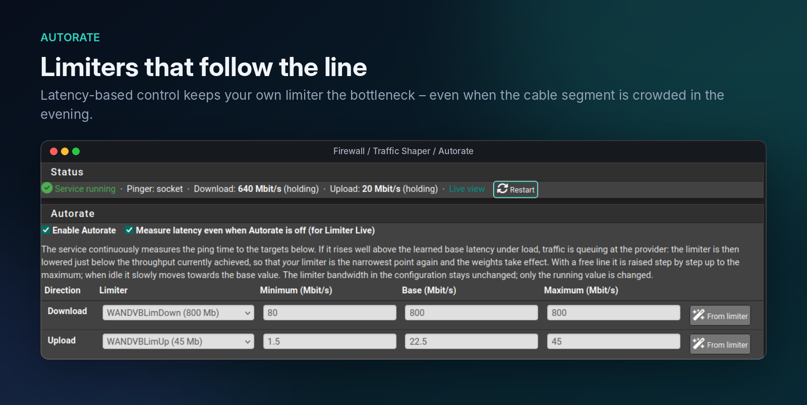
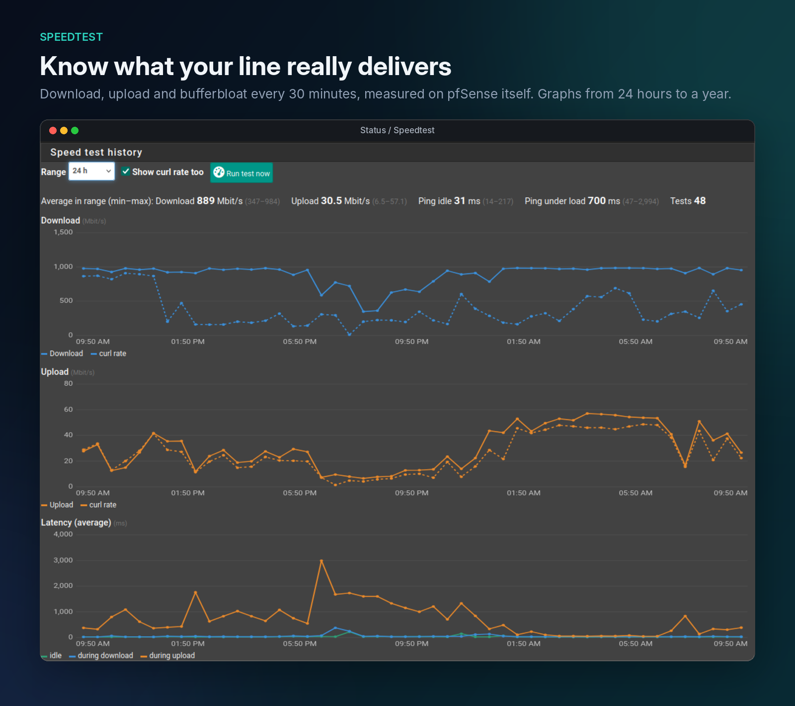
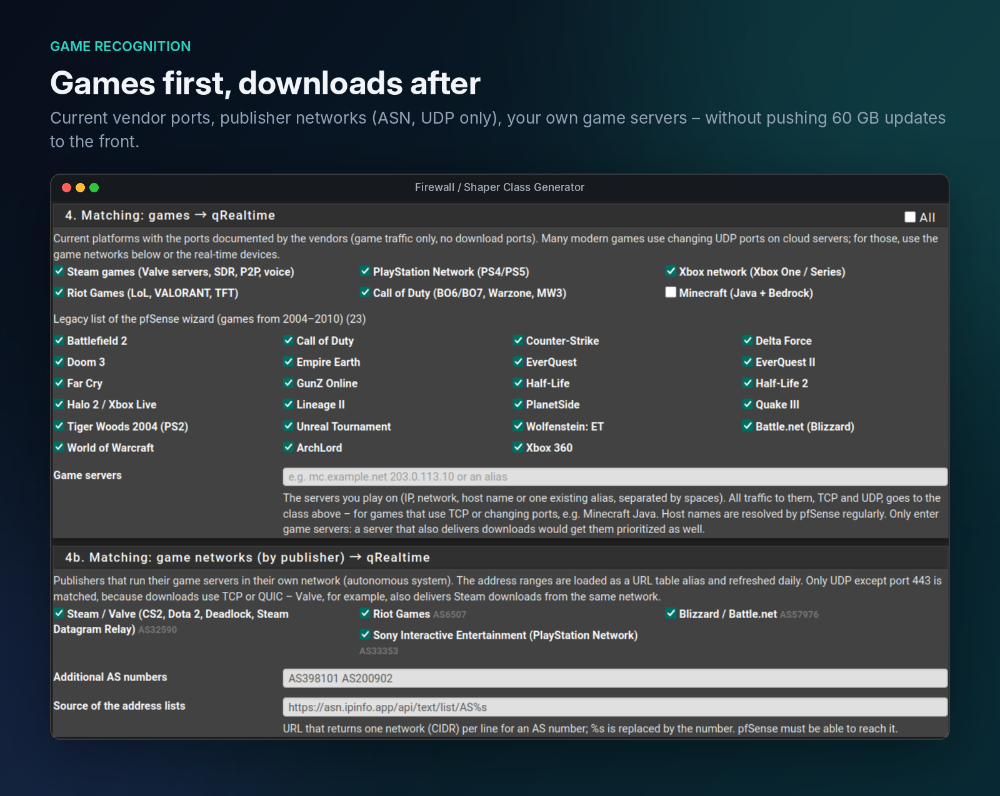

# pfSense Limiter Toolkit (pfSense-pkg-ShaperClassGen 0.5.2)

[English](README.md) · Deutsch

Klassen-Generator für den pfSense Traffic Shaper. Legt Klassen als
**Limiter-Child-Queues** unter deinen eigenen Limitern an und erzeugt die
Port-Matchings des Wizards als **Floating-Match-Regeln**.

## Klassenschemata

| Schema | Klassen (Gewicht) |
|---|---|
| **4 Klassen** (Standard für neue Installationen) | qRealtime 100 (Telefonie, Spiele, DNS/NTP/ICMP, Echtzeit-Geräte), qInteractive 50 (SSH, RDP, VNC, TeamSpeak), qDefault 20, qBulk 2 (P2P, Mail, Bulk-Geräte/Strafbox) |
| **7 Klassen** (wie der pfSense-Wizard) | qControl 100 (früher qACK), qVoIP 100, qGames 60, qOthersHigh 40, qDefault 20, qOthersLow 8, qP2P 3 |

Bestehende Konfigurationen bleiben beim Update auf dem 7-Klassen-Schema;
qACK wird dabei automatisch zu qControl. Beim Wechsel des Schemas im GUI
werden Klassen und App-Zuordnungen automatisch umgerechnet und zur Kontrolle
angezeigt; erst „Erzeugen / Aktualisieren“ ersetzt Queues und Regeln. Danach
einmal die States zurücksetzen (Diagnostics > States > Reset States).

## Installation (auf der pfSense, als root)

    fetch -o /tmp/plt.tar.gz https://github.com/coaxx77/pfsense-limiter-toolkit/archive/refs/heads/main.tar.gz
    cd /tmp && tar xzf plt.tar.gz && cd pfsense-limiter-toolkit-main
    sh install.sh

Die Befehle funktionieren auch in der Standard-Shell tcsh. Update: dieselben
Befehle erneut ausführen; Einstellungen bleiben erhalten.

`install.sh` baut mit `pkg create` ein echtes Paket und installiert es mit
`pkg add`. Danach: **Firewall > Shaper Class Generator** (zusätzlich als Tab
im Traffic Shaper).

Deinstallation: `sh uninstall.sh` bzw. `pkg delete pfSense-pkg-ShaperClassGen`.
Erzeugte Queues/Regeln bleiben dabei erhalten, vorher ggf. in der GUI
„Generierte Objekte entfernen“ klicken.

## Sprache

Die Oberfläche folgt der Sprache der pfSense (System > General Setup >
Language): Deutsch bei `de_*`, sonst Englisch.

## Ablauf

1. Gerüst manuell anlegen: Firewall > Traffic Shaper > Limiters
   - `LimDown` 950 Mbit/s, Scheduler **WF2Q+**
   - `LimUp` 47 Mbit/s, Scheduler **WF2Q+**
   (optional eigene Limiter pro VLAN – die Zuordnung ist je Interface wählbar)
2. Klassen-Generator öffnen, VLANs aktivieren, Kürzel und Priorität setzen
3. Matchings auswählen, **Vorschau**, dann **Erzeugen / Aktualisieren**

Erneutes Erzeugen ersetzt nur die eigenen Objekte (erkennbar an `[SCG]` bzw.
`SCG:` in der Beschreibung). Queue-Nummern bleiben stabil. Jede Änderung
landet in der Config-History (Diagnostics > Backup & Restore > Config History).

## Live-Status

**Status > Limiter Live** zeigt alle Limiter und ihre Child-Queues live:
Rate, Anteil an der Limiter-Bandbreite (Balken), Pakete/s, Drops und aktive
Flows. Gibt es Queues nach dem Schema `D_/U_<Kürzel>_<Klasse>`, erscheint
oben zusätzlich eine Matrix Interface × Klasse mit Download und Upload.
Die Seite funktioniert mit beliebigen Limitern, auch ohne den Generator.

Für stabile Werte muss `net.inet.ip.dummynet.expire=0` gesetzt sein, sonst
löscht dummynet kurz leere Queues samt Zählern. Die Seite bietet dafür einen
Knopf an (setzt den Wert sofort und als System Tunable).

## Autorate

**Firewall > Traffic Shaper > Autorate** regelt die Bandbreite der Limiter
laufend nach. Download-Shaping wirkt nur, solange der eigene Limiter die
engste Stelle ist; schwankt die Leitung (z. B. abends überlastetes
Kabelsegment), wird der Limiter automatisch nachgeführt.

- Der Dienst pingt 2–3 Ziele (Standard 1.1.1.1, 9.9.9.9, 8.8.8.8) mehrmals
  pro Sekunde und lernt je Ziel die Grundlatenz.
- Mehrere Proben über der Schwelle (Standard +30 ms) = Stau. Ist die Richtung
  ausgelastet, wird der Limiter auf erreichten Durchsatz × 0,9 gesenkt.
- Schafft die Leitung weit weniger als das Limit (z. B. gestörter Upstream),
  erreicht keine Richtung 50 % Last. Hält der Stau dann 2 s an, wird die am
  stärksten genutzte Richtung trotzdem gesenkt, sobald sie mindestens 2 % des
  Limits und 0,5 Mbit/s erreicht.
- „Aus Limiter“ belegt Minimum/Basis/Maximum mit 5 % (mind. 1 Mbit/s) /
  100 % / 100 % vor, Upload-Basis 50 %.
- Freie Leitung unter Last: +2 % je Takt bis zum Maximum. Leerlauf: langsam
  Richtung Basiswert.
- Gelernte Basis (Standard): Autorate merkt sich die Rate, die zuletzt unter
  Last eine Weile ohne Stau lief, und startet die nächste Übertragung dort.
  Nach einem Stau fällt sie sofort mit. Ein paar Sekunden langsameres Anlaufen
  für einen Einzelnen ist der kleinere Preis als Sekunden mit hohem Ping für alle.
- Geändert wird nur der laufende Wert (`dnctl pipe N config bw …`); die
  Konfiguration bleibt unberührt. Nach einem Filter-Reload setzt der Dienst
  seinen Wert innerhalb eines Takts neu. Beim Stoppen/Deinstallieren wird die
  konfigurierte Bandbreite wiederhergestellt.
- Dienst: `/usr/local/etc/rc.d/scg_autorate.sh start|stop|restart|status`,
  Status in `/var/run/scg_autorate.json`, Anzeige in Limiter Live.

Messmodus (Standard an): Der Dienst misst die Latenz auch, wenn Autorate aus
ist, und verstellt dann keine Limiter. Limiter Live zeigt den Verlauf der
letzten 120 s (Min–Max je Sekunde, Mittel, Grundlatenz, Schwelle, Verlust)
und Kennzahlen der letzten 10 s (Mittel, P95, Jitter, Verlust).

## Speedtest

**Status > Speedtest** (auch als Tab) misst regelmäßig (Standard alle
30 Minuten, zur Minute 7/37) die rohe Leitung direkt von der pfSense aus:

- Download und Upload mit curl gegen speed.cloudflare.com (mit Browser-Kennung
  und Referer, sonst antwortet Cloudflare bei großen Downloads mit 403), 4 parallele
  Verbindungen, je 10 s. Der Durchsatz kommt aus dem WAN-Zähler nach dem
  TCP-Anlauf; die reine curl-Rate wird zusätzlich gespeichert.
- Ping im Leerlauf, beim Download und beim Upload (Mittel, P95, Verlust) –
  zeigt Bufferbloat der Leitung.
- Läuft nur, wenn die Standardroute über das gewählte WAN geht; über eine
  Backup-Leitung (LTE/5G) wird der Test übersprungen und markiert.
- Autorate pausiert während des Tests (Limiter bleiben, nichts wird gelernt,
  Latenz wird weiter aufgezeichnet). Die Pause endet spätestens nach
  2 × Dauer + 30 s von selbst.
- Graphen für 24 h bis 1 Jahr, Tabelle der letzten Ergebnisse, Schätzung des
  Datenvolumens (bei 800 Mbit/s und 30 Minuten etwa 1 GB je Test, ~1,4 TB im
  Monat!).
- Zeitplan per cron, Verlauf in `/var/db/scg_speedtest.jsonl` (bei RAM-Disk
  für /var nach Neustart weg). Manuell: `php -f
  /usr/local/pkg/shaperclassgen_speedtest.php manual`.

## Spiele erkennen

pf und dummynet können nur Adressen, Ports und Protokolle unterscheiden; eine
Anwendungserkennung wie früher Layer7 oder heute nDPI gibt es für Limiter
nicht. Das Paket bietet deshalb vier Wege, die sich kombinieren lassen:

1. **Echtzeit-Geräte, nur UDP** (empfohlen): Konsolen, Gaming-PCs und
   VoIP-Telefone als IP/Alias eintragen. Mit „Nur UDP-Verkehr“ landen nur
   UDP-Pakete außer Port 443 in der Echtzeit-Klasse; Downloads, Updates und
   Stores (TCP bzw. QUIC) bleiben in qDefault.
2. **Spielenetze nach Anbieter (ASN)**: Valve AS32590, Riot AS6507,
   Blizzard AS57976, Sony Interactive AS33353 und eigene
   AS-Nummern. Das Paket legt je ASN einen URL-Table-Alias `SCG_AS<Nummer>`
   an (täglich aktualisiert, Quelle einstellbar, Standard
   `https://asn.ipinfo.app/api/text/list/AS%s`) und erfasst nur UDP außer 443,
   weil z. B. Valve auch Steam-Downloads aus demselben Netz liefert.
   Spiele, die nur in AWS/Google Cloud laufen, werden so nicht erkannt.
3. **Aktuelle Port-Listen** nach Herstellerangaben: Steam, PlayStation Network,
   Xbox network, Riot Games, Call of Duty, Minecraft (Java TCP 25565–25600,
   Bedrock UDP 19132–19133) – nur Spielverkehr, keine
   Download-Ports. Die alte Wizard-Liste (Spiele von 2004–2010) steht
   eingeklappt darunter.
4. **Eigene Spielserver**: IPs, Netze, Hostnamen oder ein Alias. Der gesamte
   Verkehr dorthin (TCP und UDP) landet in der Spiele- bzw. Echtzeit-Klasse –
   für Spiele mit TCP oder wechselnden Ports, z. B. Minecraft Java. Das Paket
   legt dafür den Alias `SCG_GAMESERVERS` an; Hostnamen löst pfSense
   regelmäßig neu auf.

## Was erzeugt wird

- Pro aktivem Interface und Limiter 4 bzw. 7 Queues `D_<Kürzel>_<Klasse>` bzw.
  `U_<Kürzel>_<Klasse>`. Gewicht = Klassengewicht × Prioritätsfaktor
  (Hoch 1.0, Mittel 0.5, Niedrig 0.2, oder eigener Wert), begrenzt auf 1–100.
- Pro Interface Floating-Match-Regeln am **Anfang** der Floating-Liste (vor
  allen Quick-Regeln), Richtung *in*, Ziel `!SCG_LOCALNETS`. Vorhandene
  Trenner der Floating-Liste werden automatisch mitverschoben:
  1. Catch-all → qDefault
  2. Klassenregeln von niedrig nach hoch (4 Klassen: Bulk, Interactive,
     Realtime; 7 Klassen: P2P, OthersLow, OthersHigh, Games, VoIP, Control)
     – bei Match-Regeln gewinnt die letzte passende
  3. Strafbox bzw. Bulk-Geräte (falls gesetzt) ganz zuletzt
  In-Pipe = Upload-Queue, Out-Pipe = Download-Queue. Die Beschreibung zeigt
  die Pipes, z. B. `SCG Pipe U/D_ILAN_qGames Steam` = In `U_ILAN_qGames`,
  Out `D_ILAN_qGames`.
- Alias `SCG_LOCALNETS` (RFC1918, ULA, Link-Local, Multicast): dieser Verkehr
  wird nie geshapt, Inter-VLAN bleibt also frei.

## Grenzen

- **qControl** (früher qACK): Limiter können reine TCP-ACKs nicht separat
  einsortieren (das kann nur ALTQ). Die Klasse enthält deshalb DNS, DoT, NTP
  und ICMP.
- WF2Q+ verteilt gewichtet, ist aber nicht strikt priorisiert wie PRIQ.
- Eingehende Verbindungen aus dem Internet (Port-Forwards) werden nicht
  geshapt, weil die Regeln auf *in* der LAN-Seite matchen.
- Auf den eigenen Pass-Regeln der VLANs keine In/Out-Pipes setzen, sonst
  überschreiben sie die Klassen.
- Eigene öffentliche IPv6-Präfixe in den lokalen Netzen ergänzen, sonst wird
  Inter-VLAN-IPv6 mitgeshapt.
- Das Paket kommt nicht aus dem Netgate-Repository. Nach einem pfSense-Update
  ggf. `sh install.sh` erneut ausführen.

Matching-Listen: abgeleitet aus `traffic_shaper_wizard_multi_all.inc`
(pfSense, Apache License 2.0).
