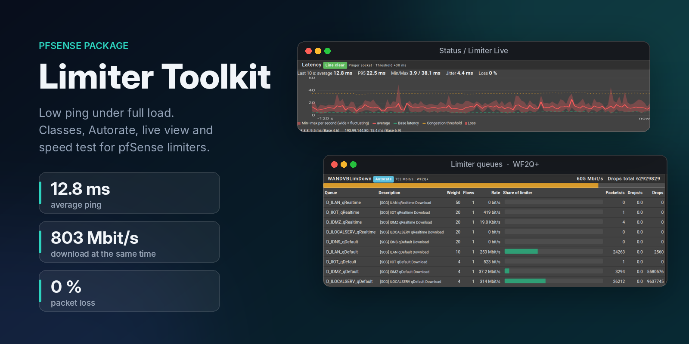
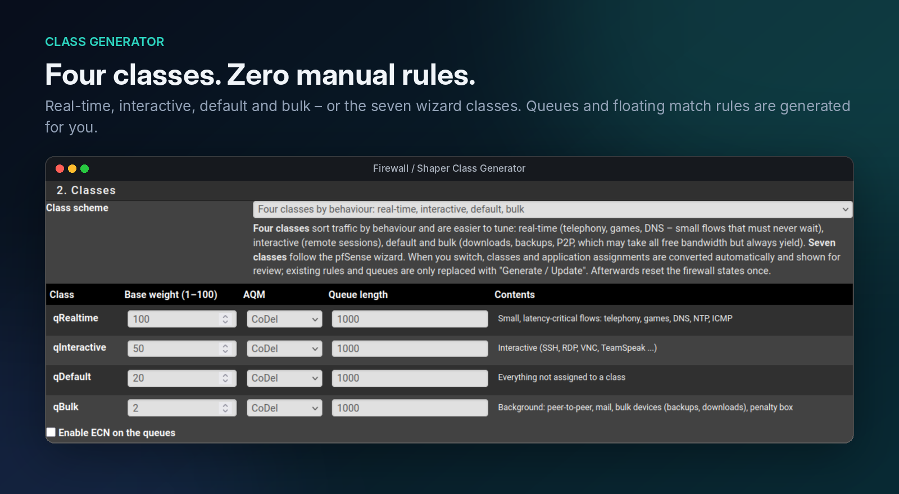
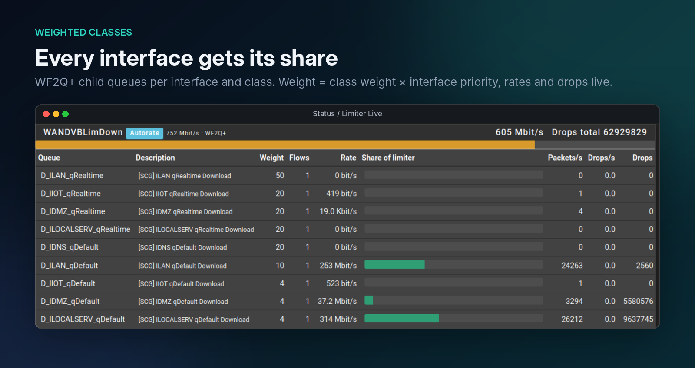
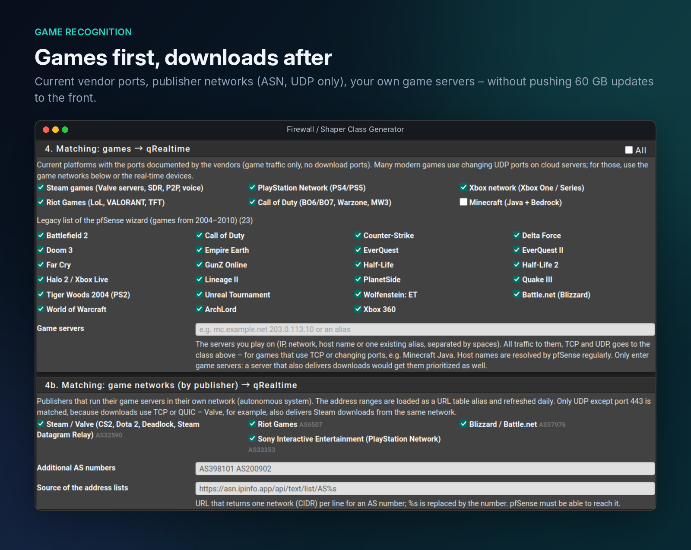
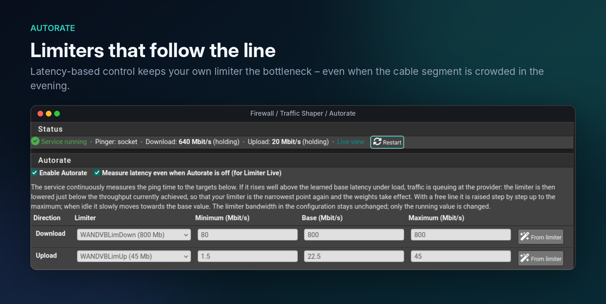
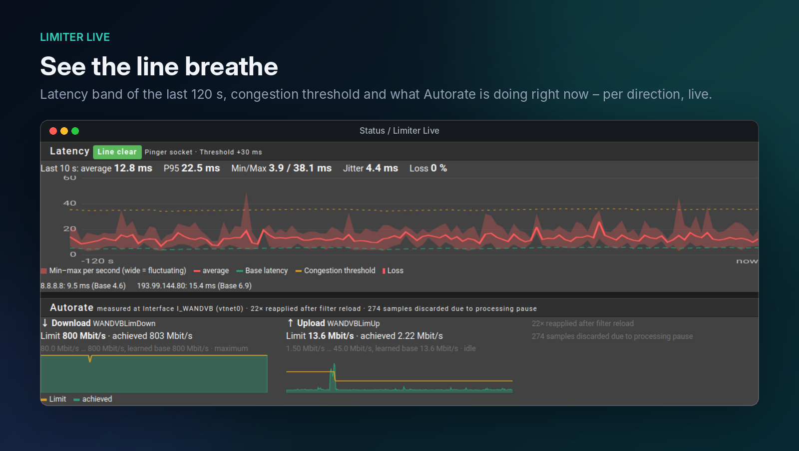
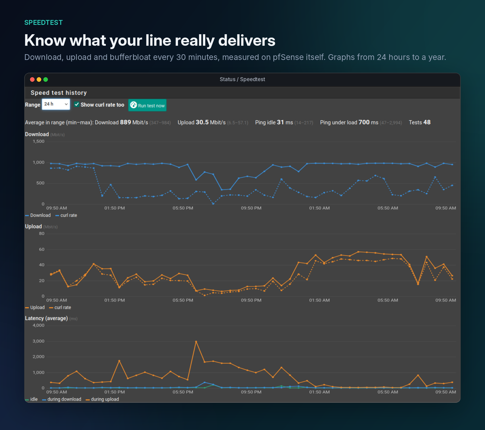

# pfSense Limiter Toolkit

English · [Deutsch](README.de.md)

A pfSense package (`pfSense-pkg-ShaperClassGen`, version 0.6.1) for traffic
shaping with **limiters** (dummynet, WF2Q+). It includes:

- **Class Generator**: creates traffic classes as limiter child queues under
  your own limiters, plus floating match rules that sort traffic into them.
- **Autorate**: continuously adapts the limiter bandwidth to the line based on
  latency, so shaping keeps working when the line fluctuates.
- **Limiter Live**: live view of limiters, queues, interfaces and latency.
- **Speedtest**: periodic speed test of the raw line with history graphs.

The GUI is English or German, following the pfSense language setting
(System > General Setup > Language).

## Installation

On pfSense as root (works in the default tcsh shell):

    fetch -o /tmp/plt.tar.gz https://github.com/betterbitsbites/pfsense-limiter-toolkit/archive/refs/heads/main.tar.gz
    cd /tmp && tar xzf plt.tar.gz && cd pfsense-limiter-toolkit-main
    sh install.sh

`install.sh` builds a real package with `pkg create` and installs it with
`pkg add`. To update, run the same commands again; settings are kept.

Uninstall: `sh uninstall.sh` or `pkg delete pfSense-pkg-ShaperClassGen`.
Generated queues and rules stay; click "Remove generated objects" in the GUI
first if you want them gone.

The package does not come from the Netgate repository. After a pfSense
upgrade, run `sh install.sh` again if needed.

## Getting started

1. Create the limiters yourself: Firewall > Traffic Shaper > Limiters, e.g.
   `LimDown` and `LimUp`, scheduler **WF2Q+**, queue management **Tail Drop**.
   Set them somewhat below the real line rate (cable: about 80–85 % of the
   plan, VDSL: about 90 % of the sync rate). Shaping only works while your own
   limiter is the bottleneck.
2. Open Firewall > Shaper Class Generator, enable the interfaces, set a short
   tag and a priority per interface.
3. Pick a class scheme and the matchings, click **Preview**, then
   **Generate / Update**.
4. Reset the firewall states once (Diagnostics > States > Reset States).

Generating again only replaces the package's own objects (marked with `[SCG]`
or `SCG Pipe` in the description). Every change ends up in the config history.

## Class schemes

| Scheme | Classes (weight) |
|---|---|
| **4 classes** (default for new installs) | qRealtime 100 (telephony, games, DNS/NTP/ICMP, real-time devices), qInteractive 50 (SSH, RDP, VNC, TeamSpeak), qDefault 20, qBulk 2 (P2P, mail, bulk devices / penalty box) |
| **7 classes** (like the pfSense wizard) | qControl 100 (formerly qACK), qVoIP 100, qGames 60, qOthersHigh 40, qDefault 20, qOthersLow 8, qP2P 3 |

Queue weight = class weight × interface priority factor (high 1.0, medium 0.5,
low 0.2 or your own value), limited to 1–100. When you switch schemes, classes
and application assignments are converted automatically and shown for review.

## What is generated

- Per enabled interface and limiter, 4 or 7 queues `D_<tag>_<class>` and
  `U_<tag>_<class>`.
- Floating match rules at the **top** of the floating list (before all quick
  rules), direction *in*, destination `!SCG_LOCALNETS`. Existing separators
  are moved along. Order: catch-all → qDefault, then the classes from low to
  high (the last matching match rule wins), then bulk devices / penalty box.
  In pipe = upload queue, out pipe = download queue; the rule description
  shows the pipes, e.g. `SCG Pipe U/D_ILAN_qGames Steam`.
- Alias `SCG_LOCALNETS` (RFC 1918, ULA, link-local, multicast): this traffic
  is never shaped, so inter-VLAN traffic stays free.
- Optional (*Options > Measure latency per interface*): one more floating
  match rule per interface at the end of the generated block, see
  [Latency per interface](#latency-per-interface).

## Recognising games

pf and dummynet can only match addresses, ports and protocols; there is no
application detection like the old Layer7 or today's nDPI for limiters. The
package offers four ways that can be combined:

1. **Real-time devices, UDP only** (recommended): enter consoles, gaming PCs
   and VoIP phones as IP/alias. With "Only UDP traffic", only UDP except port
   443 goes to the real-time class; downloads, updates and stores (TCP or QUIC)
   stay in qDefault.
2. **Game networks by publisher (ASN)**: Valve AS32590, Riot AS6507,
   Blizzard AS57976, Sony Interactive AS33353 and your own AS numbers. Each AS
   becomes a URL table alias `SCG_AS<number>` (refreshed daily; source
   configurable, default `https://asn.ipinfo.app/api/text/list/AS%s`). Only UDP
   except 443 is matched, because Valve, for example, also delivers Steam
   downloads from the same network. Empty lists are detected and skipped.
3. **Current port lists** from vendor documentation: Steam, PlayStation
   Network, Xbox network, Riot Games, Call of Duty, Minecraft (Java TCP
   25565–25600, Bedrock UDP 19132–19133). The old wizard list (games from
   2004–2010) is still available, collapsed.
4. **Your own game servers**: IPs, networks, host names or an alias. All traffic
   to them (TCP and UDP) goes to the game/real-time class, e.g. for Minecraft
   Java. The package creates the alias `SCG_GAMESERVERS`; pfSense re-resolves
   host names regularly.

## Autorate

Firewall > Traffic Shaper > Autorate adjusts the running limiter bandwidth
(`dnctl pipe N config bw …`); the saved configuration stays untouched.

- Pings 2–3 reflectors (default 1.1.1.1, 9.9.9.9, 8.8.8.8) several times per
  second and learns each one's base latency.
- Several samples above the threshold (default +30 ms) mean congestion. A
  loaded direction is lowered to achieved throughput × 0.9.
- If the line delivers far less than the limit (e.g. a disturbed cable
  upstream), no direction reaches 50 % load. If congestion persists for 2 s,
  the most used direction is still lowered, once it reaches 2 % of the limit
  and 0.5 Mbit/s.
- Clean line under load: +2 % per tick up to the maximum. Idle: slowly back to
  the base value. With the learned base (default), Autorate remembers the rate
  that last ran cleanly under load and starts the next transfer there.
- After a filter reload the service re-applies its value within one tick.
  Stopping or uninstalling restores the configured bandwidth.
- Measuring mode (default on) records latency even when Autorate is off.
- Service: `/usr/local/etc/rc.d/scg_autorate.sh start|stop|restart|status`.

Use **Tail Drop** on the limiters themselves; CoDel on the child queues is
fine and recommended. Autorate only touches the limiters.

## Limiter Live

Status > Limiter Live shows all limiters and child queues live (rate, share of
the limiter, packets/s, drops, flows), interfaces grouped WAN → VPN → shaped →
not shaped, a class matrix per interface (with the configured priority, updated live, and a *not applied* hint while saved priorities or weights have not been generated yet), the latency of the last 120 s and the
Autorate state. The service keeps the last 5 minutes of latency, limit and throughput, so the graphs are complete as soon as you open the page. A combined graph (marked *test*) shows latency and both directions over these 5 minutes in one chart: latency in ms on the left axis, throughput and limit in % of the Autorate maximum on the right, real values on hover. A second combined graph shows the history over 1–48 hours (selectable, only for this graph) from per-minute values the service stores in `/var/db/scg_autorate_history.jsonl` (48 h, lost on reboot if /var is a RAM disk); speed test periods are shaded. It works with any limiters, also without the generator.

For stable values `net.inet.ip.dummynet.expire=0` is needed; the page offers a
button that sets it immediately and as a system tunable.

### Latency per interface

Shows whether interfaces with a higher weight really get a lower latency
under load. The normal latency measurement runs from pfSense itself and never
passes a limiter, so it only shows the line. With *Class Generator > Options >
Measure latency per interface* enabled and applied:

- Every shaped interface gets its own DSCP value (DSCP pool 2, `xxxx11`,
  reserved for local use; at most 16 interfaces) and one floating match rule:
  interfaces with a gateway, direction *out*, ICMP echo request from *This
  firewall (self)* with that DSCP value → `U_<tag>_<class>` /
  `D_<tag>_<class>`.
- The queue is selectable next to the option. Default is the interactive
  class (qInteractive, or qOthersHigh with 7 classes): the comparison is meant
  to show how well the shaper protects prioritized traffic. Choose the
  real-time class for the best case or qDefault for what ordinary traffic
  gets. On a scheme switch the choice is converted with the other classes.
- The Autorate service (also in measure-only mode) pings the Autorate ping
  targets about 5 times per second per interface with that DSCP value and its
  own ICMP ID, so pf creates a separate state that runs through the
  selected queue of the interface. The ID changes every 5 minutes and after
  configuration changes, so a state created before the rule existed does not
  stay. Load: a few kbit/s per interface. Paused during speed tests.
- Limiter Live shows one row per interface, sorted by weight, plus a WAN
  reference row (same targets, no queue): average and P95 of the last 10 s,
  *queue delay* = interface latency minus WAN reference (red above 25 ms),
  and a 2-minute sparkline.

## Speedtest

Status > Speedtest measures the raw line from pfSense itself, by default every
30 minutes (at minute 7/37):

- Download and upload with curl against speed.cloudflare.com, 4 parallel
  connections, 10 s each. Throughput comes from the WAN counter after the TCP
  ramp-up; the curl rate of the test connections alone is stored as well.
- Ping idle, during download and during upload (average, P95, loss) – shows
  the bufferbloat of the line.
- Runs only if the default route goes through the selected WAN; via a backup
  line (LTE/5G) the test is skipped and marked.
- Autorate pauses during the test.
- A manual test can run **exclusive**: all limiters are throttled to a few
  kbit/s for about 30 s, so the test has the line to itself. Running
  downloads and calls pause or may drop; traffic that does not pass a limiter
  is not affected. Scheduled tests are never exclusive.
- Graphs for 24 h to 1 year, table of the latest results and an estimate of the
  data volume. **Mind the volume**: at about 1 Gbit/s and every 30 minutes, it
  is about 1 GB per test and well over 1 TB per month.
- History in `/var/db/scg_speedtest.jsonl` (lost on reboot if /var is a RAM
  disk). Manual run: `php -f /usr/local/pkg/shaperclassgen_speedtest.php manual`.

## Limitations

- Limiters cannot separate pure TCP ACKs (only ALTQ can); qControl therefore
  holds DNS, DoT, NTP and ICMP.
- WF2Q+ shares by weight; it is not strict priority like PRIQ.
- Inbound connections from the internet (port forwards) are not shaped,
  because the rules match *in* on the LAN side.
- Do not set in/out pipes on your own pass rules of the shaped interfaces,
  otherwise they override the classes.
- Add your own public IPv6 prefixes to the local networks, otherwise inter-VLAN
  IPv6 is shaped too.
- Changing rules or aliases while traffic flows reloads the limiter queues;
  queues with CoDel that are busy at that moment log
  `config_aqm Unable to configure flowset, flowset busy!` on the console. This
  is harmless pfSense/dummynet behaviour.

## License

Apache License 2.0, see [LICENSE](LICENSE). Matching lists derived from
`traffic_shaper_wizard_multi_all.inc` (pfSense, Apache License 2.0).
